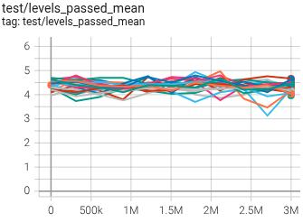
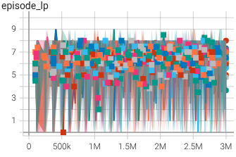

Решил сделать новую 48-ую линейку, где бы не было хаков с батч-нормом и где бы учитывались находки о бережливом аннилинге `learn_rate` и `entropy_loss.coef`. Базовая суперстудия дала на 3-ем шаге двух носителей (не густо). Потом стало понятно, что неплохо бы смотреть не на `levels_passed_mean` (который лишь косвенно учитывает рождение носителей), а на то, что происходит на раскатке. В итоге перезапуск 3-го шага с новой `decisive_metric='rollout/episode_lp_max_conv'`. Эта новая метрика - суть глобальная свёртка с треугольным фильтром, которая даёт взвешенную сумму по `rollout/episode_lp_max`. На первых порах фильтр был глобальным, потом был урезан до половины ряда, т.к. иначе начальные пертрубации оказывают нежелательное влияние на результат. `48.3b` с новой метрикой и поиском оптимальных `learn_rate` и `entropy_loss.coef` дал больше носителей, на том и поехали.

Сделал шаги с 4-го по 5-ый. С небольшими вариациям. Но вывод один. Нащупан очередной потолок (см. `18n_study_48.6b`). На роллауте (с 9-ью жизнями) агент проходит аж до 10-уго уровня, на тесте лишь до 7-го. Дальнейшего роста не просматривается. Анализ показывает, что агент проходит первые два уровня без потерь жизни, на 3-ем уровне начинает терять жизни и так по одной на каждом уровне. 9 жизней на роллауте поэтому дают ему возможность пройти дальше. Потери жизней в основном из-за стереотипного поведения. Агент выучил пару мотивов и их использует. Один из мотивов можно назвать буквой V. Агент прыгает вниз, а потом поднимается вверх немного по диагонали вправо. Если на берегу нет медведя, то он пережидает смену льдин и потом повторяет. Если есть медведь, то он медведь сжирает агента. Агент нарождается заново и повторяет манёвр - если иглу собирается, то агент в дамках. 

|исслед.|`levels_passed_mean`|`episode_lp`|
|---|---|---|
|`48.6b`|||

Так как потери жизней начинаются на 3-ем уровне, то задался вопросом - а может ли агент научиться проходить 3-ий уровень без потерь жизни? Это были 4-е исследования (`40.3f`, `40.3g`, `48.3c`, `48.3d`), итог которых зафиксирован в `18n_study_49`. Главный вывод - может. Но инструментов, как этого добиться очень мало. Один из них - это диета. Если оставить агента играть достаточно долго на третьем уровне с последней жизнью, то он находит способ преуспеть. Но при этом агент ожидаемо забывает то, как играть на других уровнях. 

Ещё из интересного. Исследования `40.3f` и `40.3g` были проведены с `is_obs_usage_enforced=True` на вижн хеде с батч-нормом. `48.3c` и `48.3d` - на вижн-хеде/энкодере без батч-норма. Явно видно, что у `40.3f` и `40.3g` явно быстрее и сильнее цепляются и показывают результат. Опять эта невидимая силу регуляризации? Потом обратил на интересный момент, что `40.3*` меньше страдают от небрежных действий. Это когда, например, агент просто сваливается со льдины ни с того, ни с сего. Или прыгает наверх аккурат между льдинами. Такое ощущение, что наличие батч-норма делает ухудшает агенту зрение. Возможно, он видит более зашумленный экран и вынужден искать более надёжные ходы (типа прыгаю всегда на середину льдины, чтобы не промахнуться). А у `48.3*` наоборот более чёткое. Хотя может всё ровно наоборот - `40.3*` - зрение лучше, а у `48.3*` зрение хуже (расплывчатее). **Короче, так или иначе схватываемость и отзывчивость линеек, где `is_obs_usage_enforced` связана с тем, что агент совершает МЕНЬШЕ небрежных действий и меньше дохнет**. На более поздних шагах той же 48-ой линейке небрежных действий я особо не заметил, т.е. это вопрос со временем закрывается.

Выход на плато (стационарность) заставляют задуматься - а как сдвинунть агента оттуда? Для этого надо, чтобы он нашёл новые мотивы действовать, а не только один-два, которые закрепились. Способом найти новые мотива - это поднимать энтропию, тогда агент будет креативать. Но это сразу будет ломать выученную политику и мешать ему проходить уже известные уровни. Если сюда ещё приплюсовать знание о том, что со временем теряется пластичность (см. заметку #137), но ситуация становится патовой. **Подняв энтропию, агент новому не научится, а старое ещё быстрее забудет** =(

Одна из проблем - это то, что энтропия действует как глобальный переключатель. Действует на всё и сразу. Подняли - агент начинает фантазировать и креативать даже там, где это не надо. Понизили - кристаллизация. Хорошая аналогия здесь физический процесс отжига. Начинаем с какой-то конфигурации, постепенно понижаем температуру - получаем какой-то внутренний узор материала. Всё, он теперь такой и есть. Если опять поднять температуру и опять отжечь, то получится уже другой узор. Никакой преемственности или направленного изменения нет. Просто заново отожгли и получили что-то новое, старый опыт потеряли. Таким способом можно нащупать варианты, у которых более успешная политика (узор). Но это требует многократного повторения. Это мне не нравится.

Мы, люди, так не делаем. Когда есть какая-то проблема, то мы фокусно её обдумываем и корректируем своё поведение только для этой ситуации. Вот что-то такое нужно и здесь. Нужен механизм, когда креативность можно поднимать точечно, направленно, в сложных моментах. Например, когда агент понимает, что в какой-то ситуации он постоянно гибнет, он может поднять креативность и попробовать что-то новое. 

Выходит нужен ещё и механизм предчувствия, **МЕХАНИЗМ ЭМОЦИЙ**. Когда всё ровно - действуем на автоматизме, оттачиваем то, что работает. Когда наступает тревога - самое время креативать. Вот эмоции и полезли - это один из важных механизмов получается корректировки поведения.

&gt; Таким образом видение дальнейших шагов корректируется - надо решать две проблемы:
&gt; 1. точечная креативность (локальная энтропия)
&gt; 2. борьба с потерей пластичности (возвращение в строй мёртвых частей сетки)