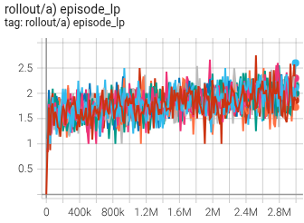
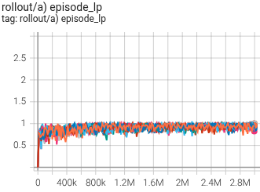
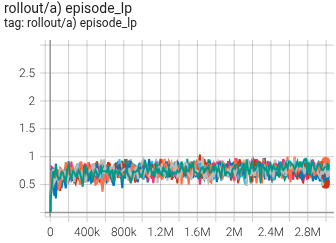
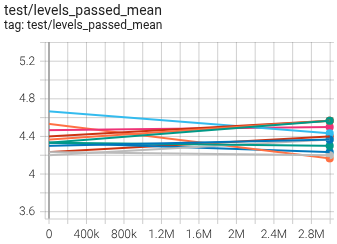

Какой был намечен план в #138:
> Таким образом видение дальнейших шагов корректируется - надо решать три проблемы:
> 1. точечная креативность (локальная энтропия)
> 2. более длинный горизонт планирования
> 3. борьба с потерей пластичности (возвращение в строй мёртвых частей сетки)

Осенило, что пункт 1 и 3 по идее можно закрыть `LoRA` адаптированием (библиотека `PEFT`). Если сделать адаптер, то через него модель станет пластичной? и там можно выкрутить энтропию для повышения исслед. способностей агента без разрушения старного опыта. Это хорошая идея попробовать.

Фундамент для `LoRA` адаптирования уже был - `18n_ppo_tr_frostbite_11`. После доработки напильником получился дуболомный вариант:
- можно сделать сколько угодно адаптеров
- адаптер активируется номером уровня, на котором играет агент. Информация приходит СНАРУЖИ
- если адаптера нет, то используется неизменная логика

> **Важно**
>
> Активация адаптера номером уровня снаружи - это читинг. В реальности модель сама должна понимать, какие адаптера активировать. Что-то типа `Mixture of Experts`. Но здесь на этот шаг я пошёл сознательно, т.к. хотелось посмотреть - в тепличным условиях оно работает или нет?

С этой дуболомной реализация получается что под каждый уровень можно нахоботить специализацию. И по факту - это будет отдельная сеть (специализированная). Если 5 адаптеров, то считай, что у тебя независимых 6 сеток: дефолтная (неадаптированная), 5 специализированных.

В ходе реализации вылезло два момента:
1. `PEFT` не работает со стоковым `nn.TransformerEncoder`, вернее со стоковым `MultiHeadAttention`. Код `PEFT` просто молча игнорирует веса, и в итоге ничего не происходит. Дело в том, что торчевский `MultiHeadAttention` реализован не через `Linear` слои, а через `fused` матрицы, когда `Q/K/V` веса все свалены в одну большую матрицу и код работы с ними не опирается на `Linear`. А `PEFT` работает только с `Linear` хорошо. Пришлось добавлять `CustomSelfAttention`, чтобы `PEFT` смог работать.
2. построчное адаптирование батча. В батче от разных энвов у нас могут быть строки, которые относятся к разным уровням. Значит, модель должна задействовать разные адаптеры для соответствующих строк. К сожалению это небесплатно. По сути всё равно сводится к циклу: разбираем батч на группу по номер уровня, для каждой группы активируем адаптер, прогоняем и т.д. И чем больше адаптеров, тем роллаут/тест получаются медленнее. Знатно так медленее.

Короче, ладно. На пеньковой тяге удалось завести адаптирование. Самый показательный выхлоп от использования - это 51-ая линейка исследований. В рамках этой линейки были разработаны специализации для игры на 3-ем, 4-ом и 5-ом уровнях. Результаты адаптирования:

|||
|---|---|
|`51.3a` |`51.4a` |
|`51.5a` ||

Ну т.е. прогресс мизерный. Углублённый анализ показал, что агент просто немного оптимизировал уже существующие навыки (подобрал хвосты), но вот прям чему-то новому и интересному не научился. 

Из хорошего - адаптирование структурно защищает прошлый опыт. Т.е. агент НЕ разучился играть на прошлых уровнях. 

А что дало адаптирование с т.з. `levels_passed_mean`? Ведь агент всё таки подтянул хвосты, значит должен проходить хоть чуточку, но дальше. И тут самыое пародоксальное явление: `levels_passed_mean` даже немного деградировал.

||
|---|
|`51.5a` |

Это вообще как? А оказалось, что дело в бонусных жизнях. Агент без адаптеров играет чуть менее оптимально на 3-ем и 4-ом уровнях. Но зато набирает чуть больше очков (чуть больше сбора кирпичей, чуть больше рыбок). А за каждые 5000 бонусов дают жазнь. В итоге неадаптированный агент приходит к 5-ому уровню с другим запасом жизней.

| метрика (paired, n=10) | `:1` база | `:166` чемпион | Δ | p |
|---|---|---|---|---|
| очков за эпизод (score_max) | **11361** | 10590 | −772 | 0.0096 |
| бонусных жизней на 300 эпизодов | **46.9** | 42.7 | −4.2 | 0.018 |
| жизней за эпизод | **5.563** | 5.423 | −0.14 | 0.018 |
| **жизней осталось на входе в L5** | **4.10** | **3.70** | −0.30 | **0.0010** |
| очков при зачистке L4 (вход в L5) | **5457** | 5381 | −76 | 0.0019 |
| очков при зачистке L3 (вход в L4) | 3401 | 3401 | 0 | — |
| `test/levels_passed_mean` | 4.523 | 4.303 | −0.22 | 0.013 |

И поэтому неадаптированный агент проходит дальше, чем адаптированный. `Вот так получается, что поднимая эффектвность в одном месте, делаем только хуже!`

Так, ладно. А почему адаптированный агент не нарабатывает новых стратегий для прохождения целевых уровней (3, 4, 5)? Мы же дали ему полную свободу действий. Подумалось, что причина может быть в замороженном энкодере. Поэтому дополнительно были проведено `18n_study_52` - просто натравливаем агента разной степени выдержки на 5-ый уровень. Результат оказался не лучше, чем при адаптировании агента.

`ВЫХОДИТ что проблема с поиском агентов новых оптимальных стратегий лежит в экшн планинге!` Давным давно реализованный механизм требует согласованности экшн планов с прошлым. В итоге агента находит решение, что проще оперировать несколькими стереотипными планами и его поведение вырождается! Попытка пошатать этот механизм через `18n_study_53`, `18n_study_54` и `18n_study_55` никаких плодов не дали. 

**Выводы**
1. нужно менять концепцию экшн планинга
2. обеспечивать пластичность агента через `LoRA` адаптирование можно и это работает
3. в реальности агент должен сам выводить, какие адаптеры подключать
4. точечная креативность может быть закрыта адаптирование
5. более длинный горизонт планировнаие требует отдельного рисерча